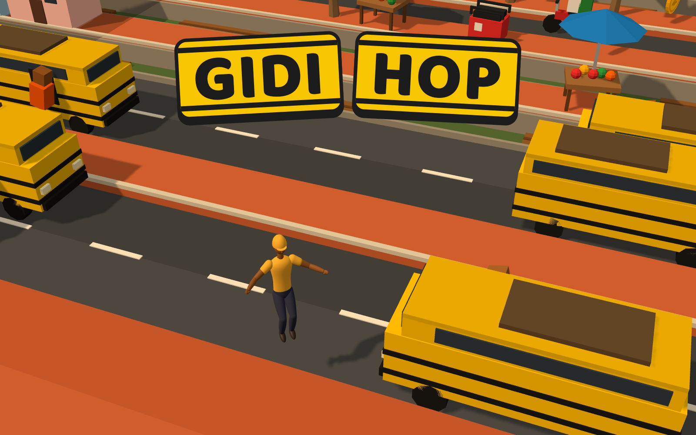

# Gidi Hop

Hop across a busy Lagos street as your own [start.ng](https://start.ng) character. Dodge danfos, okadas and kekes, ride canoes across the lagoon, cross the gutter on planks, beat the train, and grab ₦ coins on the way. Go as far as you can before the agbero catches up.

**Play:** <https://gidi-hop.start.ng>



## How to play

| Do this            | Keyboard              | Phone                       |
| ------------------ | --------------------- | --------------------------- |
| Hop forward        | ↑ or W                | Tap (or swipe up)           |
| Hop back           | ↓ or S                | Swipe down                  |
| Hop left / right   | ← → or A D            | Swipe left / right          |
| Start / play again | Space or Enter        | Tap the button              |
| Pause / resume     | P or Esc              | ⏸ button                     |
| Mute               | M                     | 🔊 button                    |

- **Score:** `hops` is the furthest row you reached; `₦ coins` are what you picked up (a gold ₦ is worth 5).
- **Close one! +₦1:** hop out of a lane just as a vehicle or train rushes through the spot you left.
- **📅 Daily Street:** one street for the whole day (Lagos time), the same for everyone, so you can compare runs with friends. The game keeps today's best on your device; daily runs also count on the main leaderboard.
- **Share score:** on the game-over screen. It opens your phone's share sheet, or copies the message and link on a computer.
- The game pauses by itself when you switch tabs or apps.
- **You lose if** a vehicle or train hits you, you land in the lagoon or gutter, a canoe carries you off the side, or you stand still too long and the camera leaves you behind (*"Agbero catch you!"*).
- It gets harder the further you go: faster traffic, longer stretches of road and wider gaps on the water.

## Run it

It's plain static files with no build step. three.js loads from jsDelivr through an import map.

```sh
python3 -m http.server 8000
# open http://localhost:8000
```

Off start.ng there's no sign-in, so the game runs as a guest with a short note. Everything else works.

Add `?debug` to expose `window.gidi` in the console (set `gidi.game.invincible = true` to stop dying), and `?seed=123` to get the same street every time.

## How it uses start.ng

- **Who's playing:** [src/platform.js](src/platform.js) asks a hidden `start.ng/connect` frame `startng:whoami`. It only accepts replies from start.ng's origin, from that frame, and with the matching `requestId`. If there's no answer within 3 seconds, the game treats that as "unknown", not "signed out".
- **Your character:** signed-in players hop as their own start.ng character (body, colours, hair, hat and accessory), built with start.ng's own character code ported to [src/character.js](src/character.js). Guests use start.ng's shared guest look. Unknown or missing style values fall back to defaults.
- **Sign in:** sends you to `start.ng/?return_to=<this page>`. When you come back, the game removes `#startng_session` from the address. Opening the game with `?guest` (start.ng's homepage already asked) skips the sign-in question.
- **Signing in or out elsewhere:** the game asks again when the tab becomes visible or gets focus.
- **Leaderboard:** [startng.json](startng.json) declares two columns, `hops` and `coins`. Signed-in players' runs are saved with `startng:score`, and the top 10 comes from `startng:leaderboard` with your own row highlighted. Your personal best and the mute setting are also kept in `localStorage`.

## Files

| File | What it does |
| --- | --- |
| [index.html](index.html) | The page: canvas, menu, HUD, game over and leaderboard screens, and the three.js import map |
| [style.css](style.css) | Danfo yellow-and-black UI, phone layout |
| [src/main.js](src/main.js) | Boots the game, menus, controls (keys, tap, swipe), game over, leaderboard, `?debug` / `?cover` |
| [src/game.js](src/game.js) | three.js scene, camera, lighting, hopping, riding, deaths, effects |
| [src/world.js](src/world.js) | Endless lane generation, traffic, canoes and planks, trains, coins, difficulty |
| [src/models.js](src/models.js) | Low-poly models: danfo, okada, keke, train, canoe, stalls, palms, houses, ₦ coins, road signs |
| [src/character.js](src/character.js) | start.ng's character (`human.ts`) in plain JS, plus a hop pose and style defaults |
| [src/platform.js](src/platform.js) | Everything that talks to start.ng |
| [src/audio.js](src/audio.js) | Sound effects made with the Web Audio API, and mute |
| [src/scores.js](src/scores.js) | Local best run and mute setting (`localStorage`) |
| [startng.json](startng.json) | Leaderboard columns for start.ng |
| [cover.png](cover.png) | 1600×1000 cover, rendered from the game (`?cover`) |
| [favicon.svg](favicon.svg) | Tab icon |
| [PROJECT.md](PROJECT.md) | The full project guide |

## Credits

Character model: start.ng's `src/three/human.ts` ([Cybertron-HNG/startng-fe](https://github.com/Cybertron-HNG/startng-fe)). Engine: [three.js](https://threejs.org) r160. Font: [Baloo 2](https://fonts.google.com/specimen/Baloo+2).
